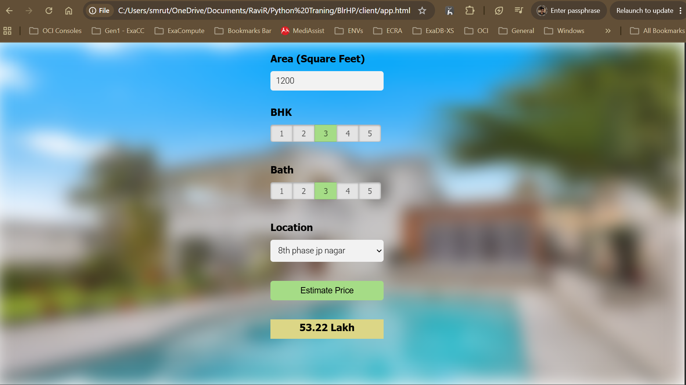

## 🏡 Bangalore Home Price Prediction by Location

**Technologies:** Python, Scikit-learn, NumPy, Pandas, Matplotlib, Flask, JavaScript

### 📌 Project Overview

Developed a machine learning-based web application to predict residential property prices in Bangalore based on location, square footage, number of bedrooms (BHK), and bathrooms.

The project uses **Python and Scikit-learn** to build and train the predictive model, **Pandas and NumPy** for data preprocessing and analysis, and **Matplotlib** for data visualization. The trained model is integrated with a **Flask REST API** and a **JavaScript-based frontend** to provide real-time home price estimates based on user inputs.

### ✨ Key Features

- 📍 Location-based property price prediction
- 📐 Price estimation based on square footage, BHK, and bathrooms
- 🤖 Machine learning model built using Scikit-learn
- 📊 Data preprocessing, analysis, and visualization
- 🔗 Flask REST API integration
- 💻 Interactive web interface built with JavaScript

### 🛠️ Technologies Used

- **Programming Language:** Python
- **Machine Learning:** Scikit-learn
- **Data Processing:** NumPy, Pandas
- **Data Visualization:** Matplotlib
- **Backend:** Flask, REST API
- **Frontend:** HTML, CSS, JavaScript

### 📸 Screenshots

<!-- Add your screenshots to the screenshots/ directory -->

#### Prediction Results


### 🚀 Getting Started

1. Clone the repository:
   ```bash
   git clone <your-repository-url>
   ```
2. Navigate to the project directory:
   ```bash
   cd bangalore-home-price-prediction
   ```
3. Install the required dependencies:
   ```bash
   pip install -r requirements.txt
   ```
4. Start the Flask application:
   ```bash
   python server/server.py
   ```
5. Open the frontend in your browser and enter the property details to get an estimated price.

### 🎯 Project Objective

To demonstrate the practical application of machine learning in real estate price prediction by combining data analysis, predictive modeling, REST API development, and frontend integration.

### ⚠️ Disclaimer

The predicted prices are estimates based on the available dataset and trained model. Actual property prices may vary depending on market conditions, property quality, amenities, and other factors.

